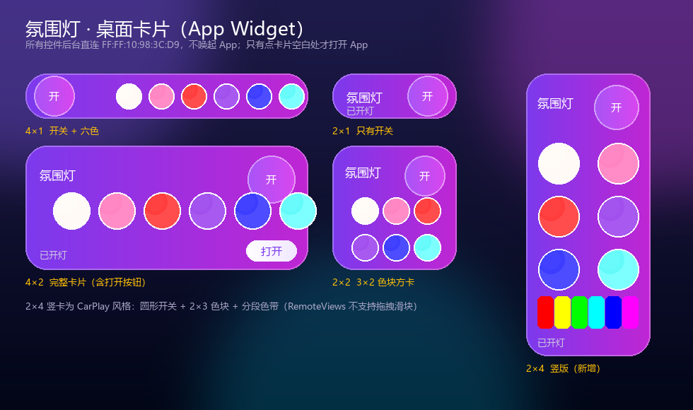
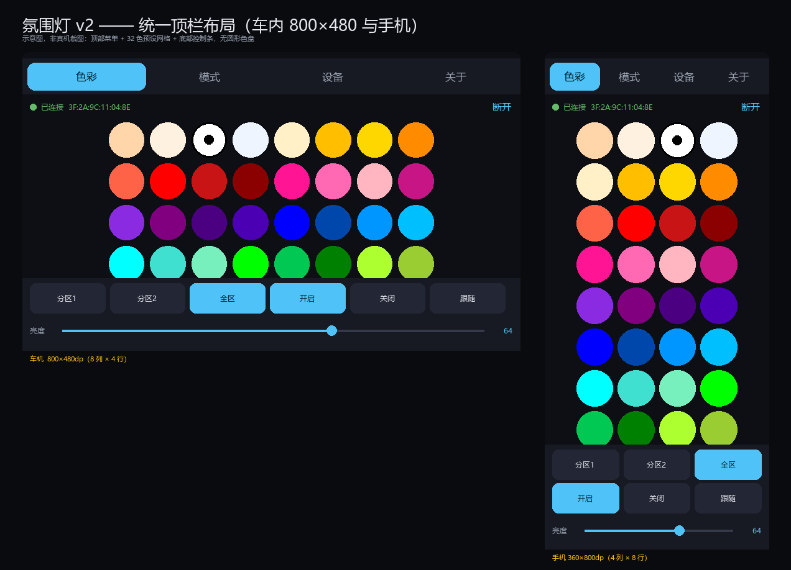

# 氛围灯 · Ambient Lamp（v2 重写版）

用 Kotlin + Jetpack Compose 重写的蓝牙氛围灯控制 App，**同时适配 800×480 车载横屏与普通手机**，
按现有固件逐字节兼容（协议由静态逆向原厂 App `com.yl.milight` 得到并已交叉验证）。

通过 **GitHub Actions 云端出包**：推到 GitHub 后自动跑单测并产出可安装的 APK。

---

## 构建状态

[](https://github.com/mki-/biansergb/actions/workflows/android.yml)

**已实测通过**（tag `v2.0.0`）：协议向量自检 → 协议单测 → 构建 debug/release → 上传产物 → 发布 Release。

### 下载安装包

👉 **[Releases · v2.0.0](https://github.com/mki-/biansergb/releases/tag/v2.0.0)**

| 文件 | 大小 | 说明 |
|---|---|---|
| `app-release.apk` | **0.93 MB** | 正式包（R8 混淆 + 资源压缩），日常安装用这个 |
| `app-debug.apk` | 9.18 MB | 调试包，`applicationId` 带 `.debug` 后缀，可和正式包共存 |

> `app-release.apk` 当前由 **Android debug 证书**签名（CI 未配密钥），可直接安装测试。
> 要上架或正式分发，按下方「正式签名」配好 4 个 Secret 后重新打 tag 即可。


---

## 一句话亮点

| | 原厂 App | 本项目 |
|---|---|---|
| 屏幕适配 | 固定竖屏、单栏 | **统一顶栏布局**：顶部菜单 + 32 色预设网格 + 底部控制条 |
| 取色方式 | 色盘拖拽 + 7 个预设 | **32 种主流预设网格**，一键直达，无拖拽精度要求 |
| BLE | inuker BluetoothKit（163 个类，已停更） | 原生 `BluetoothGatt`，~380 行，可控 |
| 写策略 | 直发无队列，律动必丢包 | 串行 + 同键合并 + 节流 |
| 断线 | 立即无限重连 | 指数退避 1→15 s 封顶 |
| 权限 | 目标 API 29，缺 `BLUETOOTH_SCAN` | 目标 API 35，12+ / 以下两套权限 |
| 签名 | 调试证书（无法发布） | CI 可选正式签名，无密钥也能出包 |
| 权限滥用 | 读存储、挂载文件系统等 | 只保留 BLE 必需项 |
| 结构 | 上帝对象 + EventBus | 纯协议模块 + ViewModel/StateFlow |

---

## 屏幕适配

**一套外壳走到底**：菜单永久在顶部，状态条在它下面，内容占满剩余高度。
没有侧栏、没有底部导航、没有圆形色盘——800×480 的横向空间富余、纵向极其宝贵，
顶部菜单是这个尺寸下最省高度的方案。

唯一随屏幕变化的只有**预设网格的列数**：

| 实机 | 物理分辨率 | 常见 density | 折算 dp | 网格 |
|---|---|---|---|---|
| 车载屏（实测） | 800×480 | mdpi 160dpi | 800×480 | **8 列 × 4 行**，单行控制条 |
| 车载屏 | 800×480 | hdpi 240dpi | 533×320 | 8 列，网格可滚动 |
| 手机竖屏 | 1080×2400 | xxhdpi 480dpi | 360×800 | **4 列 × 8 行**，控制条分两行 |
| 手机横屏 | 2400×1080 | xxhdpi | 800×360 | 8 列 × 4 行 |

其它适配手段：

* 全部尺寸用 `dp`，图标为矢量，**没有任何密度专用资源** → 同一个 APK 覆盖所有屏幕。
* 不锁 `screenOrientation`：车机就是横屏，手机可自由旋转。
* `configChanges` 含 `orientation|screenSize|density` → 旋转/换屏**不重建 Activity**，BLE 连接不断。
* 车载触摸目标放大：色块直径按可用空间取 `min(格宽, 格高)` 并夹在 30–118 dp；按钮最小 48 dp；正文字号整体上调一档（14→16 sp）。
* 连接后自动 `keepScreenOn`，熄屏不打断控制。

细节见 [`docs/screen-adaptation.md`](docs/screen-adaptation.md)。

---

## 桌面卡片（App Widget）

五种尺寸，都带圆形开关和六个固定颜色；**控件全部后台直连，不唤起 App**。



| 卡片 | 占用 | 内容 |
|---|---|---|
| 2×1 | 110×48 dp | 圆形开关 + 状态 |
| 4×1 | 250×48 dp | 圆形开关 + 六色（一行） |
| 2×2 | 110×110 dp | 圆形开关 + 3×2 色块 |
| **2×4 竖卡** | **110×250 dp** | **CarPlay 风格：圆形开关 + 2×3 色块 + 分段色带** |
| 4×2 | 250×110 dp | 圆形开关 + 六个大色块 + 打开按钮 |

交互：**点控件 = 后台连接并生效（不打开 App）**；点卡片空白处才打开 App。

- `PendingIntent.getBroadcast` → `WidgetActionReceiver`（`goAsync`）→ `QuickBleWriter`
  一次性 GATT（连→写→断）。不需要前台服务，也不需要通知权限。
- 直连已知 MAC 不需要扫描，所以后台可用。
- 「滑动颜色」做成**分段色带**：桌面卡片没有可拖拽的 `SeekBar`（RemoteViews 限制），
  一条彩虹渐变条点哪段切哪个色相是最接近的形态。
- 蓝牙地址在 `gradle.properties` 的 `ambient.pinnedMac`，颜色/色相在 `widget/WidgetCore.kt`

实现细节、取舍与自测清单见 [`docs/widgets.md`](docs/widgets.md)。

---

## 视觉风格：现代渐变风（Modern Gradient）

界面遵循 `modern-gradient` 规范，并已逐条映射到 Compose：

| 规范 | 实现 |
|---|---|
| `bg-slate-950` / `#1e1b4b` 深色底 | 页面用 `#1e1b4b → slate-950` 纵向渐变，**主区域无纯色背景** |
| `blur-3xl opacity-30` 光晕 | `GlowBackground` 用 3 个 `radialGradient` 圆（violet / fuchsia / cyan） |
| `backdrop-blur-xl bg-white/10 border-white/20` | `GlassCard`：白色 16%→6% 半透明渐变 + 白色 20% 描边 |
| `from-violet-600 to-fuchsia-600` 主渐变 | `LampGradients.violetFuchsia` — 主按钮、选中胶囊、当前 tab |
| `shadow-2xl shadow-violet-500/40` | `Modifier.shadow(ambientColor = Violet500, spotColor = Fuchsia500)` |
| `bg-clip-text text-transparent` | `TextStyle(brush = ...)`，用于 About 标题与分组标题（克制使用） |
| `hover:bg-right` 渐变位移 | 按下时叠加移动高光带（`Gradient Flow`） |
| `active:scale-95` / `rounded-2xl~3xl` | `animateFloatAsState` 缩放；圆角 16 / 24 dp，**无直角** |
| `prefers-reduced-motion` | `reducedMotion()` 读 `ValueAnimator.areAnimatorsEnabled()`，关闭动画时改用 `snap()` |

`backdrop-blur` 与 `blur-3xl` 在 Compose 里没有等价物，替代方案与取舍见
[`docs/style-modern-gradient.md`](docs/style-modern-gradient.md)。

---

## 目录结构

```
.
├── .github/workflows/android.yml   # 云端构建 + 出包 + tag 发布
├── app/                            # UI + BLE 传输层
│   └── src/main/kotlin/com/juzhen/ambientlight/
│       ├── ble/                    # LampBleClient / WriteScheduler / BlePermissions
│       ├── data/                   # DeviceStore（记住上次设备）
│       └── ui/                     # 自适应外壳、ViewModel、三个屏幕、色盘
├── protocol/                       # 纯 Kotlin/JVM，零 Android 依赖，可单测
│   └── src/{main,test}/kotlin/com/juzhen/ambient/protocol/
├── tools/                          # 协议参考实现（Python）+ 自检
│   ├── lamp_protocol.py            # 协议参考实现（可给产线/测试直接调用）
│   ├── verify_protocol.py          # 协议向量自检（CI 也会跑）
│   ├── selfcheck_kotlin.py         # 无编译器时的静态自检（括号平衡 / import 可解析）
│   ├── render_layout_mockup.py     # 生成布局示意图
│   └── push-to-github.ps1          # 一键推送脚本
└── docs/
    ├── protocol.md                 # 协议规范（帧格式/校验和/12 条命令/状态帧）
    ├── screen-adaptation.md        # 屏幕适配说明
    ├── widgets.md                  # 桌面卡片（4 尺寸 / 六色 / 自动连接）
    └── style-modern-gradient.md    # 视觉风格：Tailwind → Compose 映射与取舍
```

`protocol` 不依赖 Android，所以 `gradle :protocol:test` 能在任何 JDK 17 上秒跑。

---

## 怎么出包（GitHub Actions）

### 1. 推到 GitHub

本机若无网络，可在能联网的机器上：

```powershell
cd ambient-lamp-app
git init
git add .
git commit -m "feat: ambient lamp v2 (adaptive 800x480 + phone)"
git branch -M main
git remote add origin https://github.com/<你的账号>/ambient-lamp.git
git push -u origin main
```

或者在本机网络恢复后运行随附脚本：

```powershell
.\tools\push-to-github.ps1 -RepoUrl https://github.com/<你的账号>/ambient-lamp.git
```

### 2. 等 CI 跑完

推送后到仓库 **Actions → Android CI**：

1. `python3 tools/verify_protocol.py` —— 协议向量自检（秒级）
2. `gradle :protocol:test` —— 协议单测
3. 产出 `app-debug.apk` 与 `app-release.apk`
4. 结果在 **Artifacts → ambient-lamp-apk** 下载

### 3. 打 tag 直接发 Release

```bash
git tag v2.0.0 && git push origin v2.0.0
```

CI 会把两个 APK 附到 GitHub Release 上。

### 4.（可选）正式签名

默认 **无密钥也能出包**（release 自动回退到 debug 签名，仅供测试）。要正式签名，在仓库
**Settings → Secrets and variables → Actions** 添加：

| Secret | 说明 |
|---|---|
| `KEYSTORE_BASE64` | keystore 文件的 base64：`base64 -w0 release.jks` |
| `KEYSTORE_PASSWORD` | keystore 口令 |
| `KEY_ALIAS` | key 别名 |
| `KEY_PASSWORD` | key 口令 |

> 注意：原厂 App 用的是 Android 调试证书，你手上没有它的发布密钥，
> 所以本项目的 `applicationId` 是 `com.juzhen.ambientlight`（不是 `com.yl.milight`）。
> 换成原包名会导致"签名不一致无法覆盖安装"。改包名请动 `gradle.properties` 的 `ambient.applicationId`。

---

## 本地构建

需要 JDK 17 + Android SDK（`ANDROID_HOME`）。

```bash
# 首次：生成 wrapper（仓库不提交 gradle-wrapper.jar）
gradle wrapper --gradle-version 8.9

./gradlew :protocol:test
./gradlew :app:assembleDebug
# 产物 app/build/outputs/apk/debug/app-debug.apk
```

Windows：

```powershell
gradle wrapper --gradle-version 8.9
.\gradlew.bat :app:assembleDebug
```

> 本仓库**刻意不提交** `gradle-wrapper.jar`（二进制）。CI 用
> `gradle/actions/setup-gradle` 指定 Gradle 8.9 直接构建，因此没有 wrapper 也能出包。

---

## 界面预览



（示意图由 `tools/render_layout_mockup.py` 生成，用于评审布局密度与风格一致性，不是真机截图。）

---

## 已实现 / 未实现

**已实现**

* BLE 扫描（7 s）、连接（3 次重试 / 30 s 超时）、服务发现、通知订阅
* 双分区色彩（**32 色预设网格**）、双分区亮度、开关三态（开启/关闭/跟随）
* 流水模式（5 族 × 6 档）、速度、灯珠数量、声音灵敏度、方向、转向跟随
* 设备状态实时回读（双区亮度/模式/RGB、开关、麦克风电平）
* 内置模式快捷键、RF 遥控配对、设备信息文本上报
* 记住上次设备、断线指数退避重连

**未实现（原厂有，需另行开发）**

* 音乐律动（FFT/节拍）——需要手机麦克风算法，原厂实现未逆向
* 定时开关——建议用 `AlarmManager.setExactAndAllowWhileIdle`
* 摇一摇换色——原厂走一套未完全解码的 `0x7E…0xEF` 旧协议，建议改为"随机取色 + `0x04`"
* 说明书 PDF 阅读

---

## 协议

完整规范见 [`docs/protocol.md`](docs/protocol.md)。速记：

```
帧： 55 | L | CMD | PAYLOAD(L-1) | CK | AA
      CK = (~(L + CMD + ΣPAYLOAD)) & 0xFF

GATT：Service FFB0 / Write FFB1 (NoResponse) / Notify FFB2 / CCCD 2902

开灯        55 02 05 02 F6 AA
关灯        55 02 05 00 F8 AA
亮度100/100 55 03 02 64 64 32 AA
红(仅区1)   55 07 04 FF 00 00 00 00 00 F5 AA
速度3       55 02 23 03 D7 AA
灯珠150     55 02 26 96 41 AA
```

---

## 说明

* 本项目通过静态逆向自有设备配套 App 还原协议后重写，固件无需改动，可与原厂 App 分时使用同一台设备。
* 仅供自有设备配套使用。
